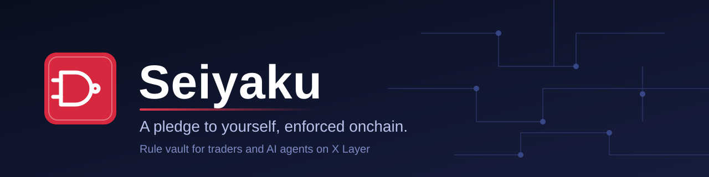
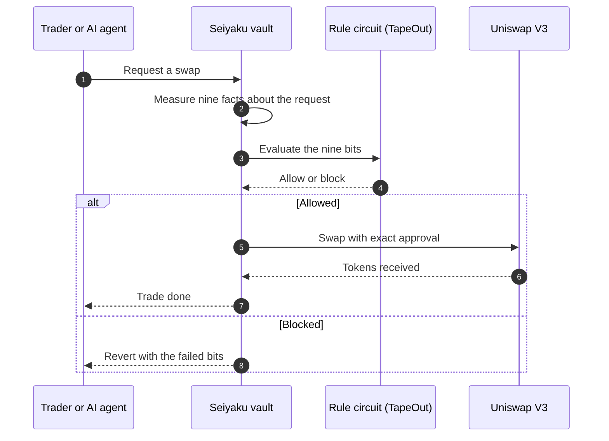
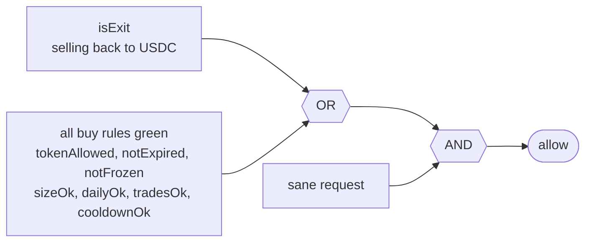
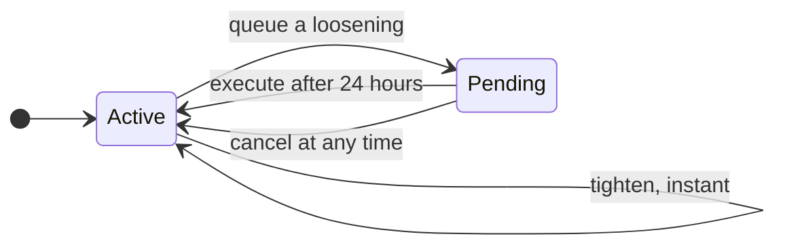
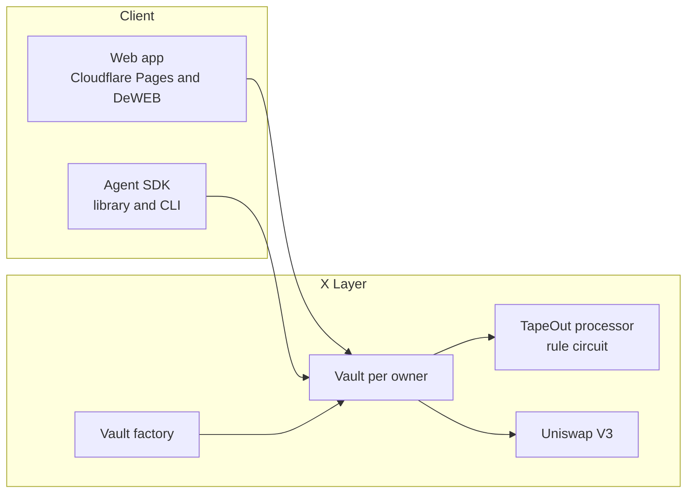

<p align="center">
  
</p>

<p align="center">
  <b>Seiyaku</b> is a vault for traders and AI agents on X Layer.<br>
  Set your rules once, calmly. Every trade must pass a rule circuit published onchain.
</p>

<p align="center">
  
  
  
  
  
  
  
</p>

<p align="center">
  <a href="#1-overview">Overview</a> ·
  <a href="#2-how-a-trade-flows">How it works</a> ·
  <a href="#3-the-rule-circuit">Rule circuit</a> ·
  <a href="#4-tighten-fast-loosen-slow">Tighten and loosen</a> ·
  <a href="#5-architecture">Architecture</a> ·
  <a href="#7-quick-start">Quick start</a> ·
  <a href="#8-security-and-limits">Security</a>
</p>

---

## 1. Overview

The name comes from the Japanese word 誓約 (seiyaku), which means a solemn pledge. You make the pledge once, when you are calm. The vault holds you to it when you are not.

Most trading losses come from broken rules, not from bad analysis. A trader promises to risk 2 percent per trade, then doubles the size after a loss. An AI agent is told to stay inside limits, then a bad prompt or a bug pushes it past them. Existing onchain guards mostly protect a swap from technical risk. Very few protect the owner from their own impulses, or from their own agent, while holding the funds behind the rules.

Seiyaku does exactly that.

| You get | What it means |
| :--- | :--- |
| **A vault with your own rules** | Funds sit in a vault that only you can withdraw from. A trader key can swap, but only inside your limits. |
| **Tighten instantly** | Any change that makes a rule stricter takes effect at once. |
| **Loosen slowly** | Any change that makes a rule weaker waits 24 hours and can be cancelled. |
| **Exits always open** | Selling back to USDC is never blocked, so protection never becomes a trap. |
| **Plain language blocks** | Every blocked trade names the exact rule that stopped it. |
| **Agent ready** | The trader key can be an AI agent. It can trade, freeze and tighten. It can never loosen a rule or withdraw. |

Seiyaku is not a trading bot. It does not pick trades. It is the supervisor that stands behind whoever does.

Built for the X Layer Build X: TapeOut Accelerate hackathon. It is an unaudited prototype and still in development.

## 2. How a trade flows



## 3. The rule circuit

The decision is made by a small circuit of NAND gates, published onchain through the TapeOut protocol. The vault measures nine facts and feeds them to the circuit as bits.



In words, a trade is allowed when its parameters are sane, and either it is an exit back to USDC, or it is a buy that passes every limit.

```
allow = sane AND ( isExit OR ( tokenAllowed AND notExpired AND notFrozen
        AND sizeOk AND dailyOk AND tradesOk AND cooldownOk ) )
```

**Limits each owner controls**

| Limit | Meaning |
| :--- | :--- |
| Single buy size | Maximum USDC spent on one buy |
| Daily volume | Maximum USDC spent on buys per UTC day |
| Daily trades | Maximum number of buys per UTC day |
| Cooldown | Minimum time between buys |
| Token allowlist | The only tokens the trader may buy |
| Expiry | Buys stop after this date, exits still work |
| Freeze | Blocks all buys at once |
| Withdrawal delay | Waiting time between a withdrawal request and payout |

**Why a circuit and not plain Solidity?** For one product, plain Solidity would also work. The circuit earns its place in four ways:

* The rule is a public object. Anyone can call it for free and see what it does, without trusting our vault code.
* Nine inputs mean only 512 possible cases, so every one of them is tested against a reference model.
* The circuit cannot call other contracts or loop, so the rule engine behaves in a strictly bounded way.
* One circuit can serve every vault. Only the numbers differ per owner.

## 4. Tighten fast, loosen slow



Tightening means making any limit stricter, such as a smaller size, fewer trades or a longer cooldown. Loosening means anything else, including adding a token, raising a limit, extending the expiry or unfreezing. A calm decision takes effect at once. A heated decision has to wait a day.

## 5. Architecture



| Part | Role |
| :--- | :--- |
| **Rule circuit** | Fixed circuit on a TapeOut processor. The factory pins its address, id and netlist hash. |
| **Vault factory** | Deploys one minimal proxy vault per owner. Holds no funds and has no admin. |
| **Vault** | Holds funds, keeps counters, builds the nine bits, asks the circuit, swaps when allowed. |
| **Circuit tools** | Builds the circuit from the rule formula, simulates it and verifies every input. |
| **Agent SDK** | Lets an agent check a trade before sending it and explain any block. |
| **Web app** | Vault builder, dashboard with timers, and a public verify page that shows any vault, its circuit as a gate diagram, and a live evaluation. |

## 6. Technology

<p>
  
  
  
  
  
  
</p>

Contracts and tests in Solidity with Foundry. Tools and SDK in TypeScript with viem and zod. A static React app with wagmi, available in English and Vietnamese. Runs on X Layer (chain id 196) with TapeOut and Uniswap V3.

```
contracts/                 Foundry project
packages/circuit-tools/    circuit builder, simulator and verifier
packages/agent-sdk/        library and command line tool for agents
apps/web/                  static web app
scripts/                   fork, deploy and publish helpers
docs/                      public documentation
```

## 7. Quick start

You need Node.js 20 or newer, npm, Git and Foundry.

```
npm ci
npm run verify
```

The verify command runs formatting, linting, type checks, unit tests, contract tests and the translation check. To work against a local copy of X Layer, set `XLAYER_RPC_URL` as shown in `.env.example` and run `npm run fork`. To test the end-to-end user story on the fork, run `npm run fork:flow`. To simulate the mainnet deployment plan without keys, run `npm run deploy:mainnet -- --dry-run`.

Never put a private key in a file in this repository. Tests use throwaway accounts that exist only on a local fork.

## 8. Security and limits

Seiyaku is an unaudited hackathon prototype. Please read this section before depositing anything.

* The contracts have not been audited. A deposit cap limits the possible loss.
* TapeOut contracts are written by a third party, are partly upgradeable and have not been audited. Seiyaku pins the circuit address, id and netlist hash. A change to the circuit stops trading but cannot take funds, and owner withdrawal keeps working.
* There are no admin keys, no upgrade path and no pause switch controlled by us.
* Version one uses no price oracle. Limits count only the USDC spent on buys.
* Fee on transfer and rebasing tokens are not supported.
* A compromised trader key can still trade inside the limits you set. That is the reason the limits exist.
* Seiyaku gives no financial advice and promises no profit.

## 9. Prior art and what was built for the event

The idea of a mandate, meaning a set of limits that an agent cannot change, was first explored by the author in an earlier offchain trading agent project. This repository contains new code written for the hackathon.

Other TapeOut projects such as TapeGuard, OpenGate and TapeSafe also use circuits to enforce rules, and they informed our understanding of what works onchain. Seiyaku differs in its focus. It protects the owner and their agent from their own impulses by holding the funds, delaying every loosening and always allowing exits.

## 10. Roadmap

* [ ] Rule circuit, factory and vault on a local fork
* [ ] Circuit tools and agent SDK
* [ ] Web app with vault builder, dashboard and verify page
* [ ] Mainnet release with a small deposit cap and verified source code
* [ ] Later: price based rules such as daily loss limits, more assets, an independent audit

## 11. Deployments

Not deployed to mainnet yet. Deployment instructions and scripts are in [docs/DEPLOY.md](docs/DEPLOY.md). Preview the dry-run plan with `npm run deploy:mainnet -- --dry-run`. Addresses and transaction links will be recorded here after live mainnet release.

## 12. License

MIT. See the LICENSE file.

This software is provided as is, without warranty of any kind. Use it at your own risk. Nothing in this repository is investment advice.
