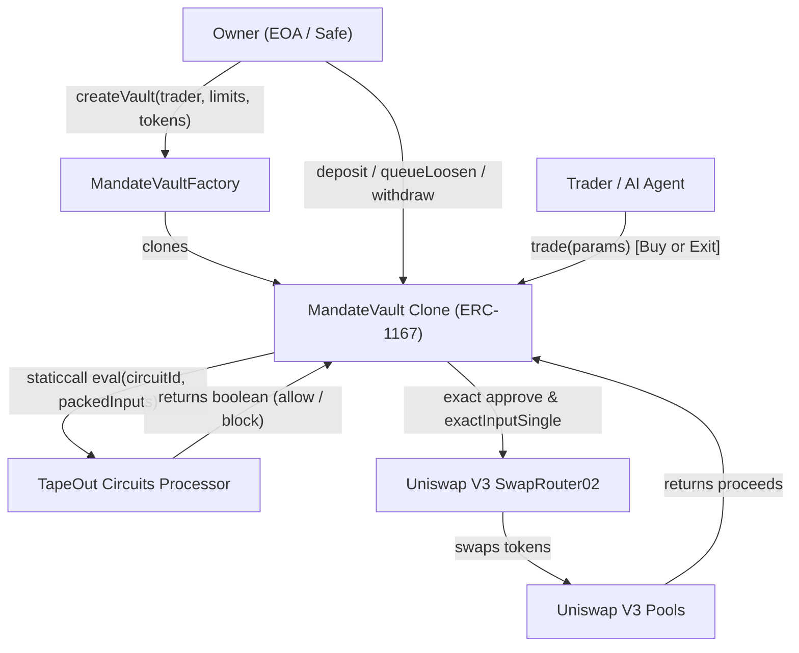
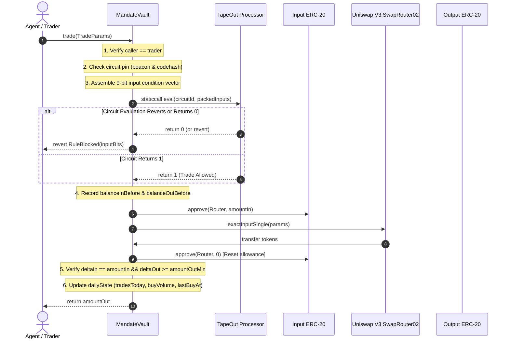

# Seiyaku Architecture Specification

This document details the architectural design, on-chain components, data flow, truth tables, and trust model of Seiyaku Mandate Vaults.

---

## 1. System Overview

Seiyaku is an on-chain mandate vault system deployed on **X Layer** (Chain ID: `196`). It delegates autonomous trading authority to secondary agent keys while restricting trade sizes, daily cumulative volumes, trade counts, cooldowns, allowlisted assets, and operational status through on-chain boolean circuit evaluation (`TapeOut` processor circuits).



---

## 2. Core Components

### 2.1 MandateVaultFactory (`src/MandateVaultFactory.sol`)

- Deploys minimal proxy clones (`Clones.clone`) of the `MandateVault` implementation.
- Verifies processor circuit integrity at creation time:
  - Validates `processor.netlist(circuitId)` matches `netlistHash` (`0xbe106fa891c4f0b430afdcf245df6a3df86508351ef76af2e1508b064dff24f5`).
  - Validates beacon implementation address and bytecode codehash.
  - Enforces `beacon.owner() == address(0)`.
- Validates initial limits via `LimitsLib.validate`:
  - `maxTradeBase > 0`
  - `maxDailyBase >= maxTradeBase`
  - `maxTradesPerDay > 0`
  - `expiresAt > block.timestamp`
  - `withdrawDelaySec >= minWithdrawDelaySec` (3,600s on production, 120s on demo).
- Maintains enumerable index of vaults per owner (`vaultsOf(owner)`).

### 2.2 MandateVault (`src/MandateVault.sol`)

- Lightweight ERC-1167 clone containing state variables:
  - `limits`: `maxTradeBase`, `maxDailyBase`, `maxTradesPerDay`, `cooldownSec`, `expiresAt`, `withdrawDelaySec`.
  - `dailyState`: `dayIndex`, `tradesToday`, `buyVolumeTodayBase`, `lastBuyAt`.
  - `pinned`: `processor`, `circuitId`, `beacon`, `beaconImplementation`, `beaconImplementationCodehash`.
  - `frozen`: boolean killswitch flag.
- Enforces access control:
  - `onlyOwner`: `deposit`, `queueLoosen`, `executeLoosen`, `requestWithdraw`, `executeWithdraw`, `setTrader`.
  - `onlyTrader`: `trade`.
  - `onlyOwnerOrTrader`: `freeze`, `tighten`, `cancelLoosen`, `cancelWithdraw`.
- Manages Uniswap V3 swap interaction with zero lingering allowance and exact balance delta checks.

### 2.3 Circuit Tools & TapeOut Processor (`@seiyaku/circuit-tools`)

- Evaluates a 17-NAND gate binary netlist (`MANDATE_V1`).
- Operates on a 9-bit input vector (packed as little-endian 2-byte array):
  - 8 condition bits (`tradeSizeOk`, `dailyVolOk`, `tradeCountOk`, `notFrozen`, `tokenAllowed`, `notExpired`, `cooldownOk`, `saneParams`).
  - 1 mode bit (`isExit`).
- Pinned on X Layer at processor address with immutable beacon implementation codehash.

### 2.4 Agent SDK & MCP Server (`@seiyaku/agent-sdk`)

- High-level TypeScript client (`AgentClient`) providing pre-flight evaluation (`check()`), trade execution (`trade()`), and rule bit explanations.
- Model Context Protocol (MCP) server providing structured tools for autonomous LLM agents with read-only defaults and pre-flight simulation.

---

## 3. Trade Data Flow

Every trade follows a strict, fail-closed verification pipeline before any tokens touch the decentralized exchange router:



---

## 4. The 9-Bit Circuit Truth Table

The `MANDATE_V1` circuit computes whether a trade is permitted. It accepts 9 boolean inputs and computes:
$$\text{Allow} = \text{saneParams} \land (\text{isExit} \lor (\text{tradeSizeOk} \land \text{dailyVolOk} \land \text{tradeCountOk} \land \text{notFrozen} \land \text{tokenAllowed} \land \text{notExpired} \land \text{cooldownOk}))$$

| Bit Index | Bit Name       |   Weight    | Evaluation Source in `MandateVault.sol`                           | Rule Condition                                               |
| :-------: | :------------- | :---------: | :---------------------------------------------------------------- | :----------------------------------------------------------- |
|   **0**   | `tradeSizeOk`  |  $2^0 = 1$  | `amountIn <= limits.maxTradeBase`                                 | Trade base amount does not exceed per-trade limit            |
|   **1**   | `dailyVolOk`   |  $2^1 = 2$  | `buyVolumeTodayBase + amountIn <= limits.maxDailyBase`            | Cumulative volume today does not exceed daily limit          |
|   **2**   | `tradeCountOk` |  $2^2 = 4$  | `tradesToday < limits.maxTradesPerDay`                            | Total trades executed today is strictly less than daily cap  |
|   **3**   | `notFrozen`    |  $2^3 = 8$  | `!frozen`                                                         | Vault is not currently frozen by owner or trader             |
|   **4**   | `tokenAllowed` | $2^4 = 16$  | `allowedTokens[token]`                                            | Target token is allowlisted                                  |
|   **5**   | `notExpired`   | $2^5 = 32$  | `block.timestamp < limits.expiresAt`                              | Vault trading mandate has not expired                        |
|   **6**   | `cooldownOk`   | $2^6 = 64$  | `block.timestamp >= lastBuyAt + limits.cooldownSec`               | Minimum cooldown between consecutive buys has elapsed        |
|   **7**   | `saneParams`   | $2^7 = 128$ | `amountIn > 0 && amountOutMin > 0 && deadline >= block.timestamp` | Parameters are non-zero, within range, and deadline is valid |
|   **8**   | `isExit`       | $2^8 = 256$ | `tokenOut == baseToken`                                           | Trade is a de-risking exit (selling back to base asset)      |

### Netlist Structure

- **Gate Count**: 17 NAND gates.
- **Input Bits**: 9 inputs ($I_0 \dots I_8$).
- **Output Bits**: 1 output bit ($O_0$).
- **Exits Rule (Property 4)**: When `isExit` ($I_8$) is 1 and `saneParams` ($I_7$) is 1, the circuit evaluates to 1 regardless of bits 0-6. Exits to base token are never blocked by cooldown, volume, trade count, expiry, or freeze.

---

## 5. Trust Model & Security Invariants

### 5.1 Role Boundaries

1. **Capital Safety**: The Trader role has zero withdrawal authorization. Capital can only exit the vault to the Owner's address via `executeWithdraw` or via authorized Uniswap V3 swaps where the recipient is strictly fixed to `address(this)`.
2. **Asymmetric Parameter Adjustments**:
   - **Tightening**: Any party (Owner or Trader) can immediately tighten limits (`tighten()`) without delay.
   - **Loosening**: Increasing limits or allowlisting new tokens requires a two-step timelock (`queueLoosen()` followed by `executeLoosen()`). The timelock delay (`loosenDelaySec`) is enforced on-chain (24 hours on production, 120 seconds on demo).
3. **Emergency Recourse**:
   - `freeze()` can be invoked immediately by either Owner or Trader to stop all buys.
   - Owner can replace a compromised or griefing Trader at any time without delay via `setTrader(newTrader)`.
   - `requestWithdraw(token, amount)` allows the Owner to withdraw funds after `withdrawDelaySec` (minimum 3,600s on production).

### 5.2 Circuit Pinning (Decision D15)

The vault clones pin their upstream TapeOut evaluation target immutably:

- `beacon`: Address of the processor's EIP-1967 upgrade beacon.
- `beaconImplementation`: Address of the logic contract referenced by the beacon at creation time.
- `beaconImplementationCodehash`: SHA-256/Keccak codehash of the implementation runtime bytecode.
- `netlistHash`: Keccak-256 hash of the 17-NAND binary netlist.

On every trade:

```solidity
if (IBeacon(beacon).implementation() != beaconImplementation) revert CircuitChanged();
if (beaconImplementation.codehash != beaconImplementationCodehash) revert CircuitChanged();
```

If an upstream beacon owner attempts an upgrade, all trades fail-closed with `CircuitChanged()`.

---

## 6. Gas & Resource Profile (Empirically Measured)

All figures measured on X Layer local fork (Block 74,254,206):

| Action                           | Measured Gas    | Target Budget | Safety Margin      |
| :------------------------------- | :-------------- | :------------ | :----------------- |
| First Buy of Day (`cold` write)  | **310,927 gas** | < 400,000 gas | 22.3% under budget |
| Subsequent Buy (`warm` write)    | **284,115 gas** | < 350,000 gas | 18.8% under budget |
| Exit Trade (`sell` to base)      | **237,298 gas** | < 300,000 gas | 20.9% under budget |
| Vault Deployment (`createVault`) | **184,520 gas** | < 250,000 gas | 26.2% under budget |
| Static Bundle Output             | **650.51 KB**   | < 800.00 KB   | 18.7% under budget |
